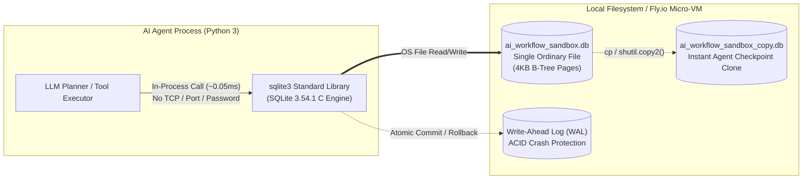

# SQLite 3.54.1 Architecture & Interactive Sandbox for AI Workflows

An interactive SQLite sandbox and visual architecture showcase demonstrating **SQLite (`3.54.1` via Python's standard-library `sqlite3`)** for local app state, prompt/embedding caches, agent memory indexes, and AI-driven workflows.

---

## 🌐 Live Links & Deployments

| Environment / Resource | Clickable URL |
| :--- | :--- |
| 🚀 **Fly.io Production Sandbox (`index.html`)** | [https://sqlite-ai-sandbox.fly.dev/index.html](https://sqlite-ai-sandbox.fly.dev/index.html) |
| 🛠️ **Fly.io SQL Query & CRUD Studio (`sql-playground.html`)** | [https://sqlite-ai-sandbox.fly.dev/sql-playground.html](https://sqlite-ai-sandbox.fly.dev/sql-playground.html) |
| 💾 **Fly.io SQLite Persistence Guide (`fly-persistence.html`)** | [https://sqlite-ai-sandbox.fly.dev/fly-persistence.html](https://sqlite-ai-sandbox.fly.dev/fly-persistence.html) |
| 📐 **Fly.io Visual Architecture Blueprint (`architecture.html`)** | [https://sqlite-ai-sandbox.fly.dev/architecture.html](https://sqlite-ai-sandbox.fly.dev/architecture.html) |
| 📂 **Fly.io Project Files & Run Guide (`files-and-run.html`)** | [https://sqlite-ai-sandbox.fly.dev/files-and-run.html](https://sqlite-ai-sandbox.fly.dev/files-and-run.html) |
| 📊 **Fly.io Live Telemetry API (`/api/status`)** | [https://sqlite-ai-sandbox.fly.dev/api/status](https://sqlite-ai-sandbox.fly.dev/api/status) |
| 💻 **Local Dev Server (`index.html` on Port 30085)** | [http://localhost:30085/index.html](http://localhost:30085/index.html) |
| 💻 **Local SQL & CRUD Studio (`sql-playground.html` on Port 30085)** | [http://localhost:30085/sql-playground.html](http://localhost:30085/sql-playground.html) |
| 💻 **Local Fly.io Persistence Page (`fly-persistence.html` on Port 30085)** | [http://localhost:30085/fly-persistence.html](http://localhost:30085/fly-persistence.html) |
| 💻 **Local Architecture Page (`architecture.html` on Port 30085)** | [http://localhost:30085/architecture.html](http://localhost:30085/architecture.html) |
| 💻 **Local Files & Run Guide (`files-and-run.html` on Port 30085)** | [http://localhost:30085/files-and-run.html](http://localhost:30085/files-and-run.html) |
| 📦 **GitHub Repository** | [https://github.com/rifaterdemsahin/sqlite](https://github.com/rifaterdemsahin/sqlite) |

---

## 📦 What SQLite Is

- 📦 **In-Process Library Engine**: A complete SQL database engine that runs inside your program as a library. There is **no server process, no port, no password, and no network**.
- 📄 **Single Ordinary File**: The whole database is one ordinary file (`sandbox_data/ai_workflow_sandbox.db`). Copying the file copies the database.
- 🐍 **Standard-Library Python Module**: Python ships it as the standard-library module `sqlite3`. Version on this Mac: **`3.54.1`**.
- 🧾 **ACID Transactions**: Transactions are ACID, so a crash mid-write leaves the file consistent.
- 🌍 **Public Domain & Ubiquitous**: It is public domain and one of the most widely deployed databases in the world (phones, browsers, apps).

## ✅ What It Is Good At

- ✅ **Local App State, Caches & Indexes**: Ideal for local application state, caches, indexes, and small-to-medium datasets (up to many GB).
- ✅ **Fast Reads with Real SQL**: `GROUP BY`, B-tree indexes, and `ON CONFLICT` upserts with zero network latency.
- ✅ **Zero Setup & Zero Running Cost**: No daemon management, no credentials to rotate, and zero idle cloud database cost.

## ⚠️ What It Is Not For

- ⚠️ **Many Simultaneous Writers**: Only one write happens at a time for the whole file.
- ⚠️ **Access Over a Network**: Putting the file on a network share (NFS/SMB) or sync tool (Dropbox/iCloud) and opening it from several machines at once can corrupt it.
- ⚠️ **Multi-User Role-Based Access Control**: Access is governed by OS file permissions rather than database-level `GRANT`/`REVOKE` roles.

---

## 🤖 How to Use SQLite in an AI-Driven World

In modern AI agent architectures, LLM pipelines, and autonomous coding workflows, SQLite has emerged as the **default embedded memory and state substrate**:

### 1. Per-Agent Episodic Memory & Checkpoint State (Portable Brain-in-a-File)
Because an entire SQLite database is **one ordinary file**, every AI agent session, subagent, or coding task can maintain its own isolated `.db` file containing conversation turns, tool call outputs, and plan state:
- **Instant Checkpointing & Branching**: Before an agent performs a risky refactoring or multi-step tool execution, `shutil.copy2("agent_state.db", "checkpoint_pre_tool.db")` clones the entire agent memory in milliseconds.
- **Crash-Proof Agent Loops**: If an LLM tool call times out or the Python process crashes mid-step, SQLite's **ACID rollback** guarantees no half-written agent state corrupts the session history.

### 2. Local Prompt, Embedding & Tool-Call Caching (`ON CONFLICT` Upserts)
LLM API calls and embedding generations are slow (hundreds of milliseconds to seconds) and expensive. Running SQLite in-process provides **microsecond cache lookups** with zero TCP/network overhead:
- Use deterministic hashes of `(model, prompt, temperature)` as primary keys.
- Use `INSERT INTO kv_cache ... ON CONFLICT(cache_key) DO UPDATE SET hit_count = hit_count + 1` to atomically cache LLM completions and track cache hit rates.

### 3. Hybrid RAG & Local Knowledge Indexes (FTS5 + Vector Extensions)
For personal AI assistants, CLI coding agents, and edge AI deployments (up to many GB of documents):
- Combine standard B-tree indexes, **SQLite FTS5** (BM25 full-text search), and `sqlite-vec` inside a single file.
- Ship pre-built knowledge bases with your container or desktop app without provisioning external vector database clusters.

### 4. Real-Time FinOps & Agent Telemetry (`GROUP BY` Analytics)
Track token usage, cost per agent role, and latency percentiles directly inside your workflow using standard SQL aggregations:
```sql
SELECT agent_name, task_type, COUNT(*) AS runs, SUM(tokens_used) AS tokens, ROUND(AVG(latency_ms), 2) AS avg_ms
FROM agent_runs
GROUP BY agent_name, task_type
ORDER BY tokens DESC;
```

### 5. Architectural Guardrails for AI Builders
- **Do use SQLite for**: Single-tenant agent sandboxes, Fly.io micro-VMs with local volumes, local CLI agents, prompt/embedding caches, and evaluation harnesses.
- **Do NOT use a single SQLite file for**: Distributed worker fleets writing concurrently over NFS/SMB shares. If 50 remote GPU workers need to write simultaneously over a network, give each worker its own local SQLite scratch file and stream aggregated events to a centralized server database, or use a single writer queue.

---

## 🏗️ Visual Architecture Overview



---

## 🚀 Running Locally & Deploying to Fly.io

### Local Sandbox (Port 30,000+)
```bash
# Run CLI benchmark & ACID verification
python3 sandbox.py --cli-only

# Start interactive web server on port 30085
python3 sandbox.py --port 30085

# Open in Google Chrome
open -a "Google Chrome" http://localhost:30085/index.html
open -a "Google Chrome" http://localhost:30085/architecture.html
```

### Fly.io Deployment (Using Azure Key Vault `dp-kv-deliverypilot`)
```bash
export FLY_API_TOKEN=$(az keyvault secret show --vault-name dp-kv-deliverypilot --name FLY-API-TOKEN --query "value" -o tsv)
fly deploy --ha=false
open -a "Google Chrome" https://sqlite-ai-sandbox.fly.dev/index.html
```
